# 環境構築手順

この手順では、Arduino IDE 2.x、ESP32 Arduino（Espressif Systems）3.x系、RotaryEncoderライブラリを準備し、WebUIからロボットを操作するまでの流れを説明します。

## 1. Arduino IDE 2.xのインストール

1. [Arduino公式サイト](https://www.arduino.cc/en/software/#ide)から、Windows用Arduino IDE 2.xをダウンロードします。

   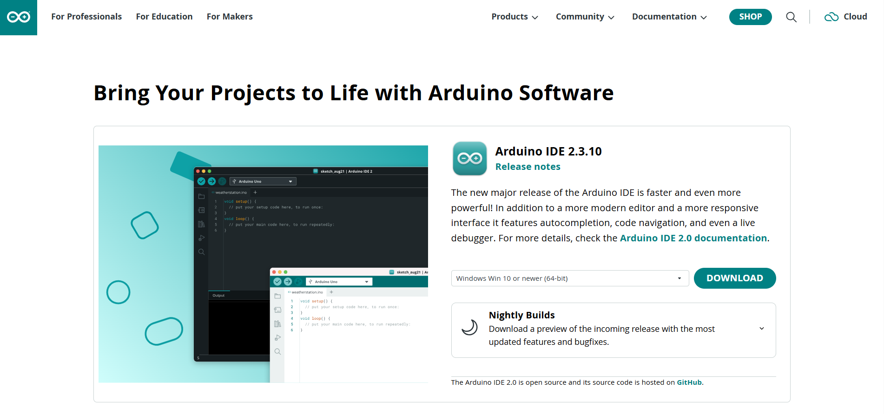

2. ダウンロードしたインストーラーを起動し、ライセンスに同意します。

   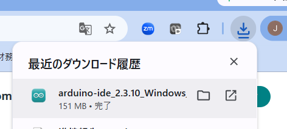
   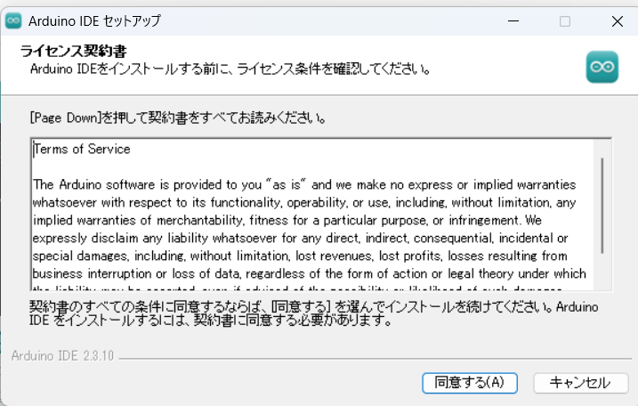

3. インストール対象は「このコンピュータを使用しているすべてのユーザ用にインストールする」を選択します。インストール先は、特別な理由がなければ既定のままにします。

   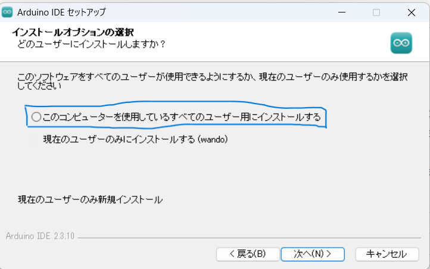
   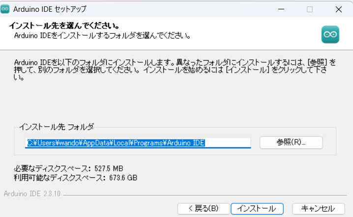

4. 「インストール」を選択し、完了画面でArduino IDEを起動します。

   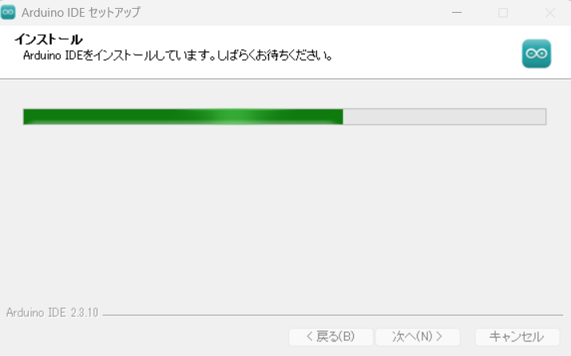
   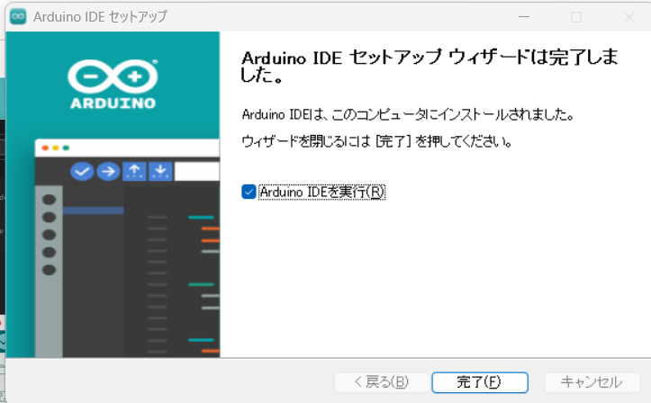

5. 初回起動時にUSBドライバーの確認が表示された場合は、内容を確認してインストールします。ボードやライブラリの更新通知は、必要に応じて後から対応できます。

   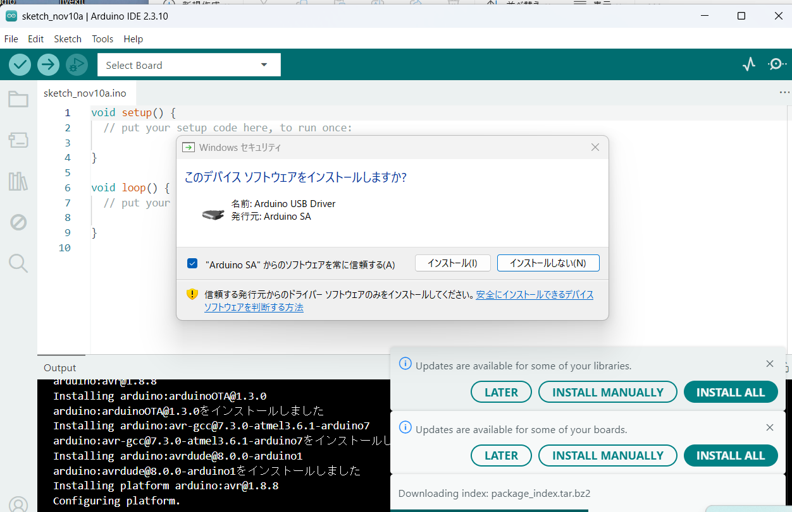

## 2. ESP32 Arduino 3.x系の設定とスケッチの書き込み

1. Arduino IDEで「ファイル」>「基本設定」を開きます。

   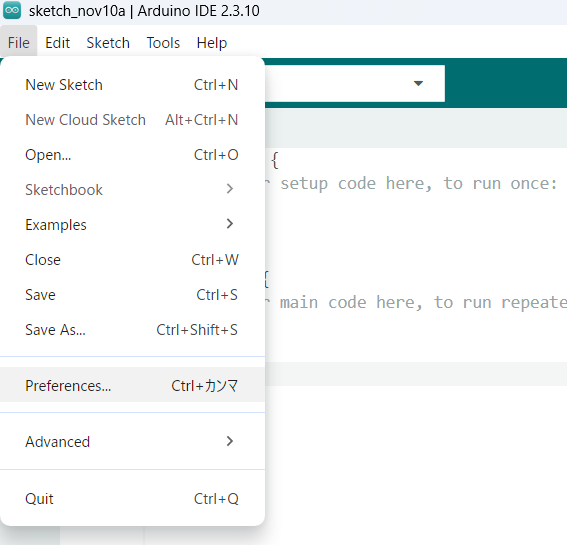

2. 「追加のボードマネージャのURL」に次のURLを追加します。既存のURLがある場合は削除せずに追加します。

   `https://espressif.github.io/arduino-esp32/package_esp32_index.json`

   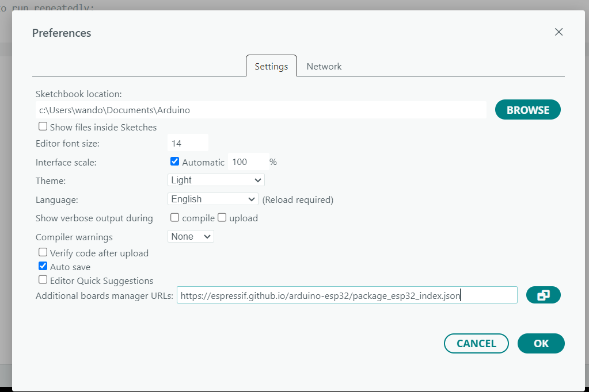

3. 「ツール」>「ボード」>「ボードマネージャ」を開き、「esp32」を検索します。提供元が「Espressif Systems」のパッケージから3.x系を選択し、インストールします。

   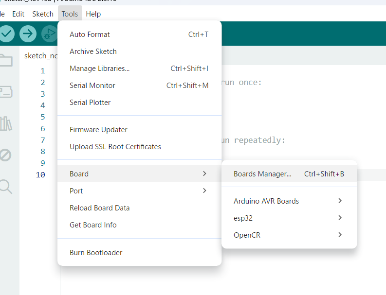
   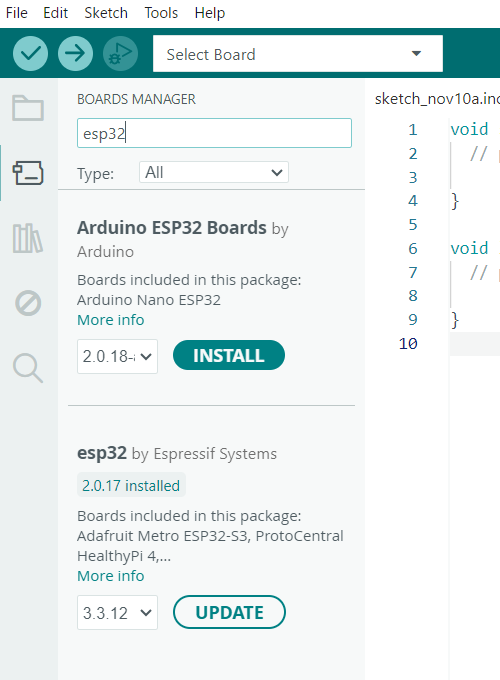

4. 「ツール」>「ボード」から使用するESP32ボードを選択します。必要に応じて「ツール」>「ポート」から接続先のCOMポートも選択します。

   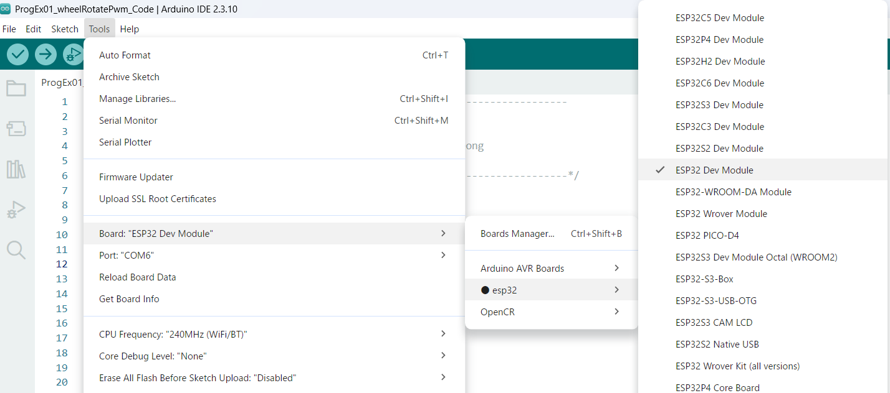

5. 「ファイル」>「開く」から対象の`.ino`ファイルを開き、ツールバーの右矢印（アップロード）を選択します。

   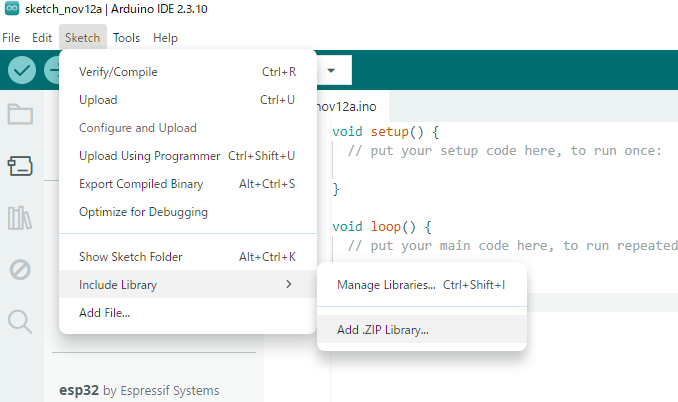
   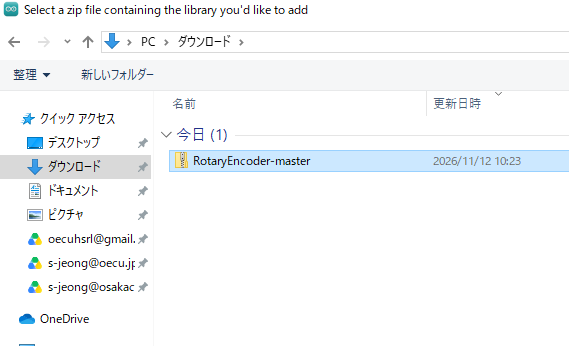

6. 出力欄に「Hard resetting via RTS pin...」と表示されたら、書き込み完了です。

   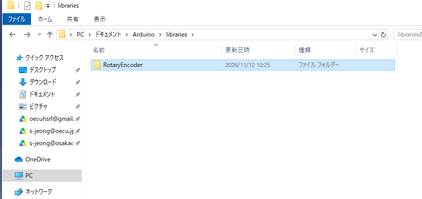

## 3. RotaryEncoderライブラリのインストール

1. [RotaryEncoderのGitHubページ](https://github.com/mathertel/RotaryEncoder)を開き、「Code」>「Download ZIP」を選択します。

   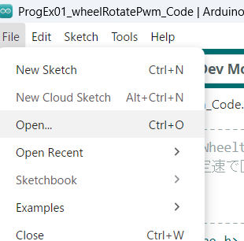

2. Arduino IDEで「スケッチ」>「ライブラリをインクルード」>「.ZIP形式のライブラリをインストール」を選択し、ダウンロードしたZIPファイルを指定します。

   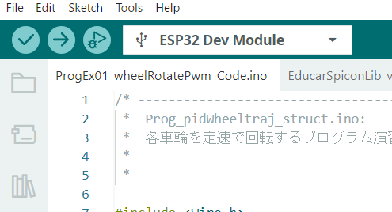
   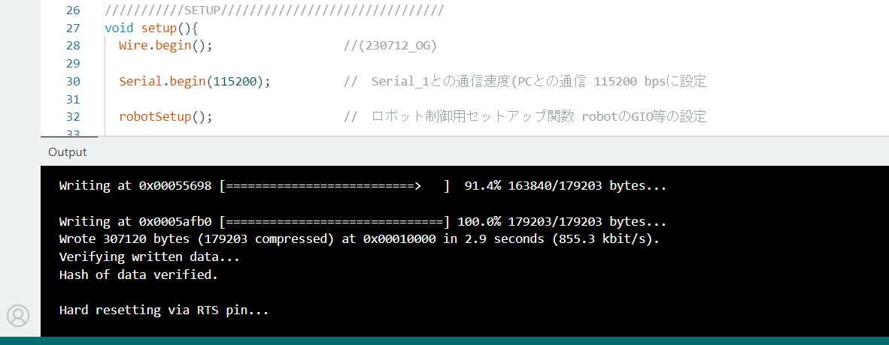

3. 「ドキュメント」>「Arduino」>「libraries」内に「RotaryEncoder」フォルダーがあることを確認します。

   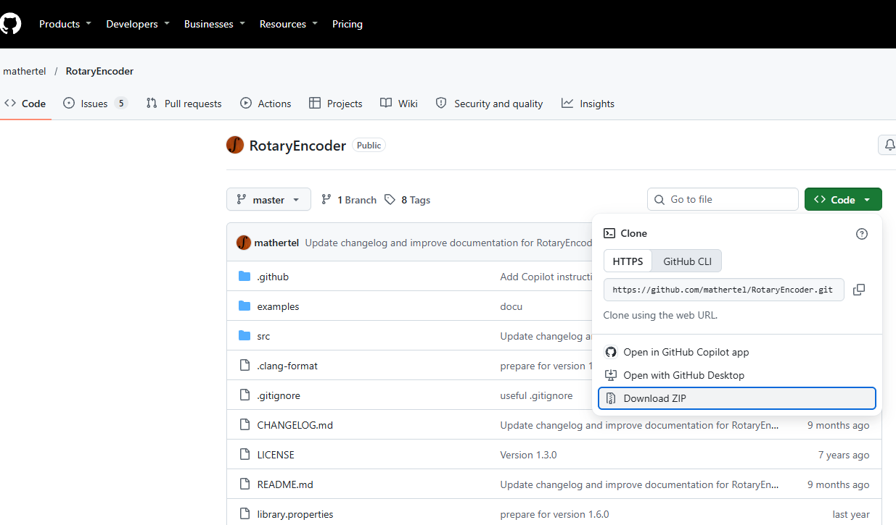

## 4. WebUIを用いた走行操作

1. 「ファイル」>「開く」から`Prog06_contVfOmegaWifi_PI`フォルダーを開き、`Prog06_contVfOmegaWifi_PI.ino`を選択します。

   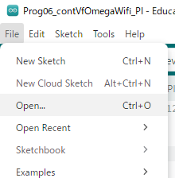
   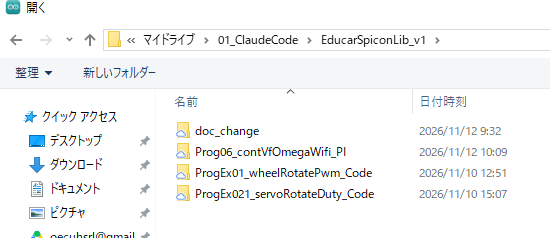
   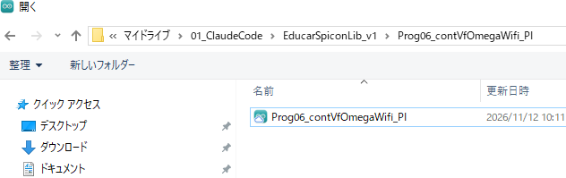

2. `EducarUiWifi1.0.cpp`タブを開き、`ssid`を接続時に識別できる名前に変更します。`password`は8文字以上に設定します。

   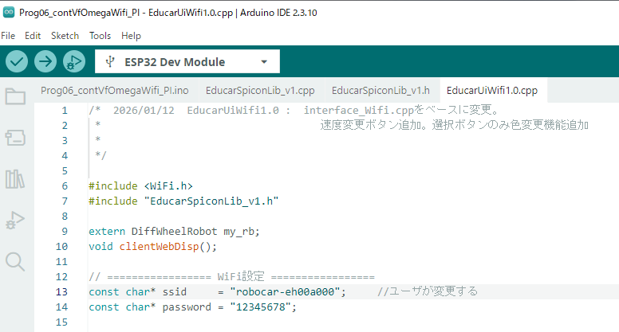

   Wi-Fi一覧には、ここで設定した`ssid`と同じ名前が表示されます。

3. 「ツール」>「ボード」>「esp32」から「ESP32 Dev Module」を選択します。

   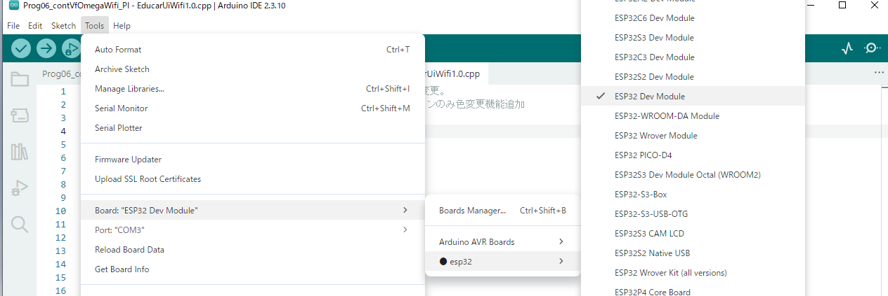

4. USB接続前に「ツール」>「ポート」を開いて表示を確認します。ESP32をUSB接続した後、再度ポート一覧を開き、新しく表示されたCOMポートを選択します。

   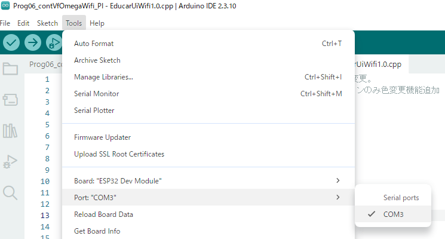

5. ツールバーの右矢印（アップロード）を選択して、コンパイルと書き込みを実行します。「Hard resetting via RTS pin...」と表示されたら書き込み完了です。

   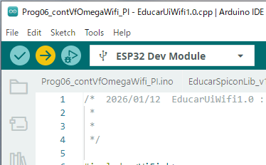
   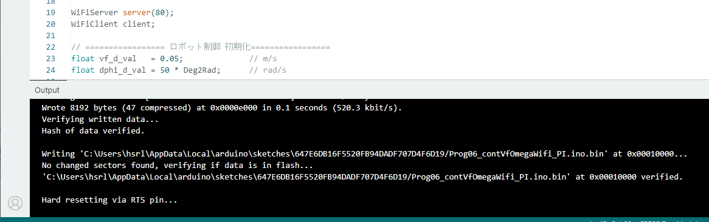

6. PCまたはスマートフォンのWi-Fi一覧から、手順2で設定したSSIDを選択して接続します。

   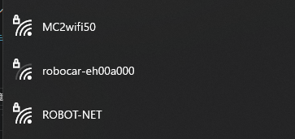

7. Webブラウザーのアドレス欄に`http://192.168.0.3`を入力します。コントローラーが表示されたら、周囲の安全を確認してから基板の電源を入れ、操作します。

   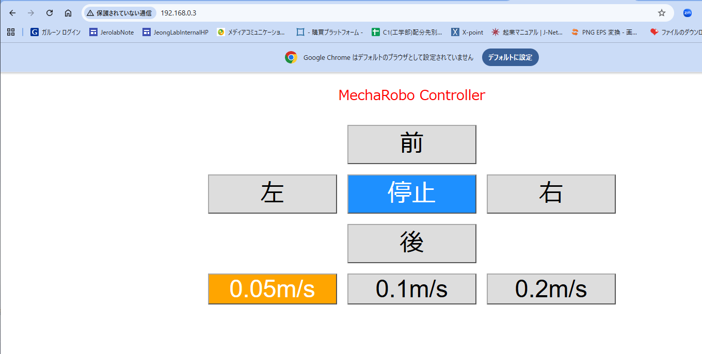
